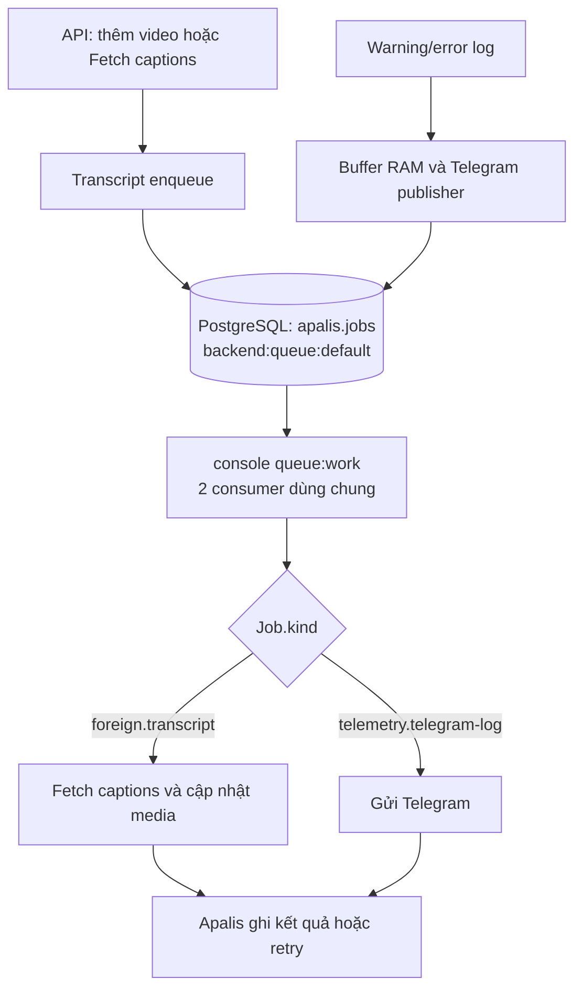
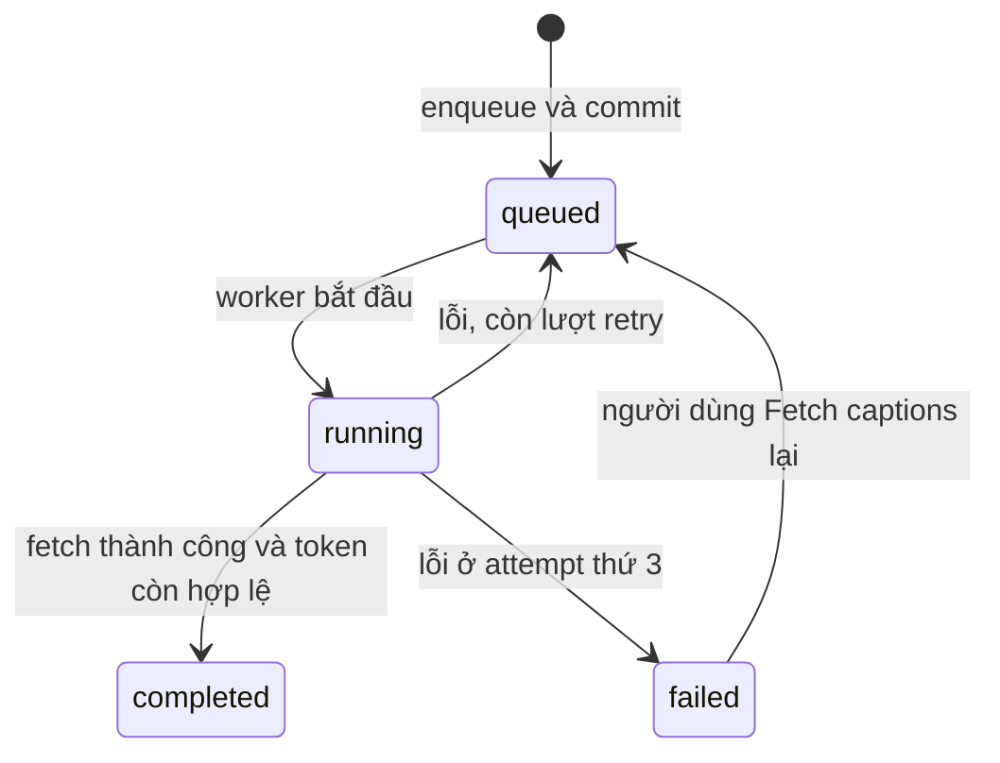

# Backend queue: flow, cách chạy và lifecycle

Tài liệu mô tả code hiện tại: PostgreSQL lưu job qua Apalis; API dispatch job;
`console queue:work` chạy các consumer trong một process.

## 1. Cấu trúc hiện tại

| Thành phần | Giá trị hiện tại |
| --- | --- |
| Channel mặc định | `default` |
| Tên queue trong PostgreSQL / `apalis.jobs.job_type` | `backend:queue:default` |
| Loại job transcript | `foreign.transcript` |
| Loại job Telegram | `telemetry.telegram-log` |
| Consumer mỗi channel, mỗi process | 2 |
| Batch size | 1 job mỗi lần lấy |
| Retry | Thêm 2 lần, tổng tối đa 3 attempts cho các job hiện tại |
| Backoff | 30 rồi 60 giây |
| Channel bổ sung | Chỉ thêm khi module khai báo |

Channel và loại job là hai thông tin khác nhau. Hai loại job cùng nằm trong
`default`; registry dùng `kind` để chọn handler. Hai consumer có thể xử lý tối đa
hai job đồng thời trong một process; một channel không có nghĩa là xử lý tuần tự.
Nếu chạy thêm process worker, tổng concurrency cũng tăng tương ứng.



Payload lưu trong queue có cấu trúc chung:

```json
{
  "kind": "foreign.transcript",
  "payload": {
    "id": "uuid-cua-task",
    "media_id": 123,
    "video_id": "youtube-id"
  }
}
```

`kind` chọn handler; `payload` là dữ liệu riêng của loại job. Priority, attempts,
lịch chạy và idempotency key nằm trong metadata/cột của job Apalis.

## 2. Bản đồ từng file

Các đường dẫn bên dưới tính từ thư mục `backend`.

| File | Trách nhiệm |
| --- | --- |
| [apps/console/src/main.rs](../apps/console/src/main.rs) | Nhận lệnh `queue:work` và gọi command tương ứng. |
| [apps/console/src/commands/queue.rs](../apps/console/src/commands/queue.rs) | Khởi tạo process worker: config, DB, registry, consumer, shutdown. |
| [crates/app-config/src/config_source.rs](../crates/app-config/src/config_source.rs) | Đọc `.env` tại working directory, rồi ghi đè bằng environment của process. |
| [crates/app-config/src/database_config.rs](../crates/app-config/src/database_config.rs) | Đọc `DB_*`, tạo PostgreSQL connection options. |
| [crates/app-resources/src/lib.rs](../crates/app-resources/src/lib.rs) | Tạo pool DB dùng chung; chạy setup/migration queue; đóng pool lúc shutdown. |
| [crates/app-resources/src/queue.rs](../crates/app-resources/src/queue.rs) | `Job`, tên channel, storage, registry, consumer loop, retry và chuyển queue cũ. |
| [modules/foreign/src/config.rs](../modules/foreign/src/config.rs) | Channel dispatch và priority mặc định của Foreign; danh sách channel bổ sung. |
| [modules/foreign/src/infrastructure/postgres_queue.rs](../modules/foreign/src/infrastructure/postgres_queue.rs) | Validate config Foreign, tạo queue key, đổi priority sang giá trị Apalis. |
| [modules/foreign/src/infrastructure/transcript_queue.rs](../modules/foreign/src/infrastructure/transcript_queue.rs) | Dispatch transcript trong transaction; đăng ký handler; xử lý trạng thái media. |
| [modules/foreign/src/infrastructure/captions.rs](../modules/foreign/src/infrastructure/captions.rs) | Gọi YouTube để lấy và chuẩn hóa caption segments. |
| [modules/foreign/src/presentation/http/media.rs](../modules/foreign/src/presentation/http/media.rs) | Dispatch khi thêm video từ form cũ hoặc bấm Fetch captions. |
| [modules/foreign/src/presentation/http/youtube.rs](../modules/foreign/src/presentation/http/youtube.rs) | Dispatch khi thêm video từ trang Channels vào listening. |
| [crates/app-telemetry/src/lib.rs](../crates/app-telemetry/src/lib.rs) | Thu warning/error, publisher ghi job Telegram và handler gửi Telegram. |
| [apps/console/src/bin/migrate.rs](../apps/console/src/bin/migrate.rs) | Entry point binary `migrate`. |
| [apps/console/src/migrations.rs](../apps/console/src/migrations.rs) | Chạy migration các module rồi setup/upgrade queue. |
| [deploy/supervisor/backend-queue.conf](../deploy/supervisor/backend-queue.conf) | Chạy một worker process lâu dài, restart khi process lỗi. |
| [modules/todos/src/infrastructure/worker.rs](../modules/todos/src/infrastructure/worker.rs) | Vòng xử lý Pomodoro/Web Push riêng, được khởi chạy cùng command. |

## 3. Cách chạy ở môi trường development

Chạy từ thư mục `backend` để các process đọc đúng `.env`.

Cấu hình DB trong `backend/.env`:

```dotenv
DB_HOST=127.0.0.1
DB_PORT=5432
DB_NAME=your_database
DB_USERNAME=your_user
DB_PASSWORD=your_password
```

API và worker phải trỏ đến cùng database. Environment của process có độ ưu tiên
cao hơn `.env`; thay `.env` cần khởi động lại process để đọc cấu hình mới.

Áp dụng migration trước:

```sh
cd backend
make migrate
```

Chạy API ở một terminal:

```sh
cargo run --locked -p api-gateway
```

Chạy worker ở terminal khác:

```sh
cargo run --locked -p console --bin console -- queue:work
```

Hoặc dùng `make queue-worker`. Nếu chỉ chạy API, job được ghi vào DB nhưng chưa có
consumer xử lý cho đến khi worker được bật.

Với Docker Compose của repo, các lệnh tương đương là:

```sh
# Chạy từ thư mục gốc repo, các container cần đang hoạt động.
docker compose exec backend cargo run --locked -p console --bin migrate -- up
docker compose exec backend cargo run --locked -p console --bin console -- queue:work
```

Lệnh worker chạy foreground. Nếu worker đã được Supervisor quản lý thì dùng
Supervisor để quản lý process hiện có, thay vì vô tình khởi chạy thêm một process.

Để bật Telegram, cấu hình ở cả API và worker:

```dotenv
TELEGRAM_LOG_ENABLED=true
TELEGRAM_BOT_TOKEN=your_bot_token
TELEGRAM_CHAT_ID=your_chat_id
TELEGRAM_LOG_LEVEL=warning
```

`GOOGLE_API_KEY` dùng cho API danh sách kênh/video. Handler transcript hiện lấy
caption qua trang YouTube và timedtext trong `captions.rs`; nó không gọi YouTube
Data API bằng key này.

## 4. Lifecycle khi worker khởi động

Entry point đi qua `main.rs` → `commands/queue.rs::run()`:

1. Đọc config bằng `ConfigSource::load()`.
2. Tạo pool PostgreSQL qua `AppResources::connect()`; tối đa 10 connections.
3. Kiểm tra bảng `apalis.jobs` và `todo_pomodoro_states` tồn tại. Thiếu migration
   thì process báo lỗi ngay, không tự tạo schema trong worker.
4. Đọc cấu hình dispatch Foreign và khởi tạo telemetry.
5. Tạo một `Registry` rồi gọi hai hàm đăng ký:
   - Foreign đăng ký `foreign.transcript`.
   - Telemetry đăng ký `telemetry.telegram-log`.
6. Gọi `app_resources::queue::run()` với registry, pool và channel bổ sung.
7. Hàm `channels()` luôn thêm `default`, validate các channel được khai báo thêm,
   loại trùng và giới hạn tối đa 16 channel.
8. Tạo 2 consumer cho mỗi channel, mỗi consumer dùng batch size 1 và cùng registry.
9. Đồng thời chạy vòng Pomodoro/Web Push của Todos và chờ tín hiệu shutdown.

Consumer có tên dạng:

```text
backend:queue:default:<instance-uuid>:<index-0-den-1>
```

Tên instance giúp phân biệt các lần khởi động và các process khác nhau.

Todos hiện vẫn xử lý các bảng trạng thái/outbox riêng bằng vòng tick mỗi giây.
Nó chưa dispatch `Job` vào Apalis, nên vòng Todos không tạo thêm channel queue.
Các command bảo trì Wallets cũng vẫn có lịch chạy riêng.

## 5. Lifecycle một job transcript

### 5.1. HTTP request tạo nhu cầu xử lý

Có ba điểm chính:

- Thêm video từ form Listen: `media.rs` lưu media rồi enqueue với priority automatic.
- Thêm video từ Channels: `youtube.rs::add_listening()` lưu/tái sử dụng media rồi
  enqueue với priority automatic.
- Bấm Fetch captions: `media.rs` enqueue với priority manual.

Hiện automatic là Normal, manual là High. API trả kết quả sau bước lưu/dispatch;
việc gọi YouTube lấy captions diễn ra trong worker.

Việc tạo media và việc enqueue là hai transaction riêng. Riêng job transcript và
trạng thái/token transcript của media được ghi chung trong transaction enqueue.
Nếu tạo media thành công nhưng enqueue lỗi, media có thể vẫn tồn tại để thử lại.

### 5.2. `transcript_queue.rs::enqueue()` ghi job

Hàm mở transaction rồi khóa media bằng `SELECT ... FOR UPDATE`.

- Nếu trạng thái đã là `queued` hoặc `running`, không tạo job trùng.
- Nếu đã có transcript/segments, không tạo job ghi đè.
- Nếu có thể chạy, tạo `TranscriptTask` với UUID mới.
- Ghi `transcript_task_id`, đặt trạng thái `queued`, xóa lỗi cũ.
- Bọc task vào `Job { kind: "foreign.transcript", payload: ... }`.
- Ghi job vào `backend:queue:default`, đặt priority và `max_attempts = 3`.
- Commit job và trạng thái media cùng lúc.

Nếu một bước trong transaction thất bại thì cả job lẫn token/trạng thái mới được
rollback. UUID task là token dùng để kiểm tra kết quả còn phù hợp với media.

### 5.3. Consumer chọn handler

Apalis lấy job từ queue và gọi handler chung trong `app-resources/queue.rs`.
`Registry::execute()` tìm handler theo `job.kind`, truyền payload và attempt hiện
tại vào handler đã đăng ký.

Với `foreign.transcript`, handler deserialize payload thành `TranscriptTask`, rồi
gọi `run_once_with()` và `captions::captions()`.

Tên `kind` chưa được đăng ký hoặc payload sai định dạng sẽ trả lỗi và đi qua retry;
worker không đoán handler bằng nội dung payload.

### 5.4. Fetch và cập nhật kết quả

`run_once_with()` kiểm tra media còn tồn tại, video ID đúng, task token còn khớp
và chưa có transcript do người dùng nhập. Nếu job đã cũ, handler bỏ qua an toàn.

Với job hợp lệ:

1. Đặt media thành `running`, commit transaction.
2. Gọi YouTube bên ngoài transaction DB.
3. Có caption: `complete()` khóa media và kiểm tra lại token trước khi ghi segments,
   transcript, trạng thái `completed` và xóa lỗi.
4. Có lỗi: lưu lỗi, chuyển media về `queued` nếu còn lượt thử; attempt thứ ba chuyển
   thành `failed`. Handler trả lỗi để Apalis xử lý retry.



Đây là trạng thái **transcript trong media**, tách biệt trạng thái job trong
`apalis.jobs`. Job có thể hoàn tất vì đã cũ và được bỏ qua, dù không ghi transcript.
Việc chỉnh sửa transcript thủ công làm vô hiệu task token để kết quả đến muộn
không ghi đè nội dung người dùng.

## 6. Lifecycle một job Telegram

Toàn bộ ở `crates/app-telemetry/src/lib.rs`:

1. Tracing layer nhận warning/error theo mức log cấu hình, che dữ liệu nhạy cảm,
   giới hạn độ dài và đưa vào buffer RAM bằng thao tác không chờ.
2. Buffer chứa tối đa 1.024 sự kiện; publisher chạy nền đọc buffer.
3. Publisher loại nội dung trùng trong khoảng 60 giây.
4. Bọc log vào `Job` với kind `telemetry.telegram-log`.
5. Dispatch vào `default`, priority 5, tối đa 3 attempts. Mỗi lần dispatch có một
   idempotency key; retry ghi DB dùng lại key đó.
6. Consumer chung chọn handler Telegram rồi gọi HTTP `sendMessage`.
7. HTTP timeout là 5 giây; response cần vừa có status thành công vừa có `ok=true`.
8. Gửi lỗi thì trả lỗi cho retry chung 30/60 giây. Nếu Telegram yêu cầu chờ qua
   `retry_after`, handler còn chờ tối đa 60 giây trước khi trả lỗi.

Nếu ghi queue thất bại, publisher thử lại sau 2 giây; đây là retry **ghi DB**, khác
với retry **thực thi job** của Apalis.

Nếu Telegram bị tắt ở worker nhưng vẫn có job đã lưu, handler trả lỗi
`Telegram delivery is disabled`; job vẫn chịu giới hạn attempts. Cần bật cấu hình
tương ứng khi muốn xử lý các alert đó. Không có command retry Telegram thủ công
riêng trong code hiện tại.

Job đã ghi vào PostgreSQL tồn tại qua restart process. Sự kiện còn nằm trong RAM
có thể mất khi process bị kill hoặc buffer đầy. Delivery không bảo đảm exactly-once;
Telegram có thể nhận trùng nếu gửi đã thành công nhưng việc xác nhận kết quả bị lỗi.

## 7. Priority, concurrency và retry

| Nguồn job | Priority ghi vào Apalis |
| --- | --- |
| Fetch captions thủ công | 9 — High |
| Transcript tự động khi thêm video | 5 — Normal |
| Telegram log | 5 — Normal |
| Job chọn Low | 0 — Low |

Apalis ưu tiên giá trị lớn hơn. Giá trị này được chuyển qua
`Priority::queue_priority()`; không dùng trực tiếp giá trị `as` của enum Foreign.

Priority chỉ ảnh hưởng việc chọn job đang chờ, không ngắt job đang chạy. Transcript
và Telegram chia sẻ cả queue lẫn concurrency nên có thể chờ nhau khi cả 2 consumer
đang bận. Không còn các queue `high`, `normal`, `low` riêng.

Khi handler trả lỗi, middleware retry có thể thực thi lại job. Sau khi hết attempts,
job kết thúc thất bại. Với transcript, media cũng được đánh dấu `failed` để người
dùng thấy và có thể Fetch captions lại bằng một task token mới.

## 8. Shutdown và restart

`commands/queue.rs` chờ Ctrl+C/SIGINT hoặc SIGTERM. Một consumer dừng bất thường
cũng khiến process bắt đầu shutdown và trả lỗi để Supervisor restart.

Trình tự shutdown:

1. Phát tín hiệu dừng tới shared queue và vòng Todos.
2. Shared queue phát tín hiệu dừng tới từng consumer, đợi tối đa 60 giây cho nhóm
   consumer kết thúc; quá hạn sẽ abort các task còn lại.
3. Command đợi các nhóm worker tối đa 90 giây, rồi dừng task còn lại.
4. Telemetry đóng buffer và cố ghi các log còn lại vào PostgreSQL, tối đa 15 giây.
5. Đóng pool DB dùng chung sau khi worker/publisher dừng.
6. Process thoát. Supervisor restart nếu cấu hình yêu cầu.

Job chưa xử lý vẫn nằm trong DB. Job đang chạy mà bị kill cần cơ chế recovery của
Apalis; các handler phải chịu được việc thực thi lại. Không tự suy ra job thành
công chỉ vì process worker đã khởi động lại.

Template Supervisor đặt `numprocs=1`, `autorestart=true`, `stopsignal=INT` và
`stopwaitsecs=120`. Đường dẫn làm việc và log nằm trong
[backend-queue.conf](../deploy/supervisor/backend-queue.conf).

## 9. Build và chạy production

Build từ thư mục `backend`:

```sh
make build
```

Với deployment đã dùng queue cũ, quy trình cập nhật:

1. Chuẩn bị binary mới; chuyển API publishers sang bản mới để không còn dispatch
   vào tên queue cũ.
2. Dừng/drain worker cũ, chờ job đang chạy kết thúc.
3. Chạy migration bằng binary mới.
4. Khởi động worker mới bằng Supervisor.

```sh
# Từ thư mục backend trên máy triển khai, với quyền quản lý Supervisor phù hợp.
supervisorctl stop nvnhan0810-queue
./target/release/migrate up
supervisorctl start nvnhan0810-queue
supervisorctl status nvnhan0810-queue
```

Nếu thay đổi cấu hình Supervisor, dùng `supervisorctl reread` và
`supervisorctl update` để áp dụng. Không chạy lại worker binary cũ sau khi đã đổi
payload sang envelope mới. Database ứng dụng chưa được migrate chỉ bởi việc sửa
source code; cần chạy lệnh migration trên đúng môi trường.

## 10. Chuyển các queue cũ sang default

Luồng migration:

```text
migrate binary
  → console::migrations::apply(Up)
  → migration schema các module
  → app_resources::migrate_queue()
  → Apalis setup schema
  → queue::migrate_legacy()
```

`migrate_legacy()` chuyển bốn tên queue cũ đang có:

```text
foreign:queue:youtube-transcript:high
foreign:queue:youtube-transcript:normal
foreign:queue:youtube-transcript:low
backend:queue:telegram-logs
```

Về `backend:queue:default`, đồng thời:

- Bọc payload gốc vào envelope có `kind` phù hợp.
- Chuyển priority từ lane cũ thành thuộc tính job.
- Giữ ID, attempts, max attempts, lịch chạy, metadata và idempotency key.
- Chạy trong transaction; chạy lại không bọc payload lần thứ hai vì tên queue cũ
  đã được đổi.
- Từ chối chuyển nếu còn job ở queue cũ có trạng thái `Running`.

Việc chuyển áp dụng cả các bản ghi lịch sử có tên queue thuộc danh sách trên.
Nó không tự đổi mọi queue tùy ý khác trong database. Migration down của các module
không hoàn tác phép chuyển envelope/queue này.

## 11. Thêm loại job hoặc channel cho module mới

**Chỉ thêm loại job:** dùng `default` hiện có.

1. Định nghĩa payload serialize/deserialize của module.
2. Đăng ký một `kind` duy nhất trong hàm `register_jobs()` của module.
3. Gọi hàm đăng ký đó từ `commands/queue.rs`.
4. Producer bọc payload trong `Job::new(kind, payload)` và dispatch vào default.

Ví dụ producer; giả sử `task` là payload của module:

```rust
use apalis::prelude::*;
use app_resources::queue::{self, Job, DEFAULT_CHANNEL};

let mut storage = queue::storage(&pool, DEFAULT_CHANNEL);
storage
    .push_task(
        TaskBuilder::new(Job::new("reports.generate", task)?)
            .priority(5)
            .max_attempts(3)
            .build(),
    )
    .await?;
```

Nếu job cần commit cùng dữ liệu nghiệp vụ, dùng transaction-aware
`apalis_postgres::queries::push_tasks()` như transcript, thay vì dispatch bằng
storage riêng sau khi transaction nghiệp vụ đã commit.

**Thêm channel riêng:** khai báo thêm rồi mới dispatch vào channel đó.

Ví dụ tùy chọn khi sửa cấu hình Foreign để dành riêng channel `captions`:

```rust
Self {
    channels: vec!["captions".into()],
    dispatch: DispatchConfig {
        channel: "captions".into(),
        ..DispatchConfig::default()
    },
}
```

Kết quả: consumer chạy cho `default` và `captions`. Cấu hình hiện tại vẫn để
`channels: vec![]` và dispatch `default`.

Với module mới, command trung tâm phải gộp danh sách channel module đó vào tham số
`additional` truyền cho `queue::run()`. Hiện command lấy danh sách bổ sung từ
Foreign. Chưa có cơ chế tự quét mọi module để tìm channel hoặc handler.
Đăng ký handler không tự tạo channel mới; `kind` và channel được khai báo riêng.

## 12. Quan sát và kiểm tra

Xem số job theo queue/trạng thái:

```sql
SELECT job_type, status, count(*)
FROM apalis.jobs
GROUP BY job_type, status
ORDER BY job_type, status;
```

Xem các worker đã đăng ký:

```sql
SELECT worker_type, count(*)
FROM apalis.workers
GROUP BY worker_type;
```

Bảng worker có thể chứa lịch sử; số bản ghi không tự chứng minh số process đang
sống. Kết hợp trạng thái Supervisor và log khởi động/dừng consumer.

Các bài kiểm tra liên quan:

- [app-resources queue tests](../crates/app-resources/src/queue.rs): chỉ thêm channel
  được khai báo, phân phối các loại job đến đúng handler.
- [Foreign config tests](../modules/foreign/src/infrastructure/postgres_queue.rs):
  mặc định không sinh lane/channel riêng, custom dispatch cần được khai báo.
- [queue_worker.rs](../apps/console/tests/queue_worker.rs): migration queue cũ có thể
  chạy lại, dispatch transcript atomic, một queue dùng chung, restart/shutdown worker.
- [foreign_features.rs](../apps/console/tests/foreign_features.rs): regression các
  tính năng Foreign, transcript và ownership.

Chạy unit tests từ `backend`:

```sh
cargo test --locked -p app-resources -p app-telemetry -p foreign --lib
```

Integration tests được đánh dấu `ignored` vì cần PostgreSQL test riêng, rỗng.
`QUEUE_TEST_DATABASE_URL` còn yêu cầu môi trường trust auth theo fixture worker.
Không trỏ các biến test vào database ứng dụng: fixture tạo schema/dữ liệu và có
bước dọn/rollback.

```sh
QUEUE_TEST_DATABASE_URL='<disposable-postgresql-url>' \
  cargo test --locked -p console --test queue_worker -- --ignored

FOREIGN_TEST_TARGET='<another-disposable-postgresql-url>' \
  cargo test --locked -p console --test foreign_features -- --ignored
```
